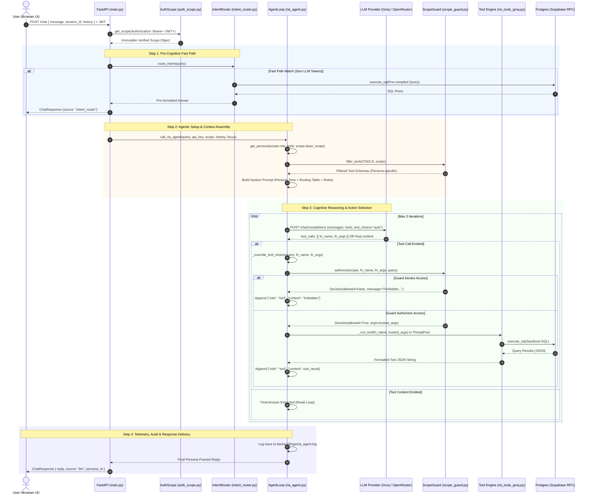

# RIA (Research Intelligence Agent) — Complete Agentic Architecture & Flow

> **Document Version:** 1.0.0  
> **Target System:** KLE Technological University — Research Intelligence Agent (RIA)  
> **Source Modules:** `backend/ria_agent.py`, `backend/scope_guard.py`, `backend/ria_tools_groq.py`, `backend/persona/`, `backend/auth_scope.py`, `backend/sql_tool.py`, `backend/intent_router.py`

---

## 1. Executive Summary & Agent Architecture Paradigm

The **Research Intelligence Agent (RIA)** is a specialized, autonomous, enterprise-grade AI system engineered for academic and institutional research analytics at **KLE Technological University**. 

Unlike generic conversational chatbots that answer from parametric memory or generate free-form SQL queries, RIA operates as a **Deterministic, Tool-Calling, Goal-Directed Agent** adhering to the **ReAct (Reasoning + Acting)** paradigm with strict multi-tenant Role-Based Access Control (RBAC).

```
 ┌─────────────────────────────────────────────────────────────────────────────┐
 │                             RIA AGENT PARADIGM                              │
 ├─────────────────────────────────────────────────────────────────────────────┤
 │  1. Zero Memory Hallucination: Never answers research data from weights.    │
 │  2. Two-Layer Boundary: Voice/Framing (Persona) != Data Security (Guard).   │
 │  3. Zero-Trust Tool Calling: Model arguments are sanitized & untrusted.     │
 │  4. Identity Injection: Real session identity is injected at runtime.       │
 │  5. Bounded Determinism: Max 3 cognitive loops, strict schema enforcement.  │
 └─────────────────────────────────────────────────────────────────────────────┘
```

---

## 2. Core Agentic Concepts in RIA

RIA implements several foundational patterns from modern autonomous agent engineering:

### 2.1 The ReAct (Reasoning + Acting) Cycle
The agent operates through an iterative cognitive loop:
1. **Observation**: Agent ingests user query, contextual conversation history, and active dashboard focus.
2. **Reasoning (Thought)**: An LLM reasoning model analyzes available tool schemas, maps intent to tool capabilities, and determines required parameters.
3. **Action (Tool Call)**: The agent emits structured tool invocations (`function_call`).
4. **Execution & Interception**: The backend intercepts the call, validates permissions, injects trusted scope parameters, and executes deterministic SQL.
5. **Observation (Tool Result)**: Raw database results are formatted into JSON and fed back into context as a `tool` role message.
6. **Synthesis / Reflection**: The agent either synthesizes a natural language answer aligned with its persona, or triggers a secondary tool if sequential data is required (up to 3 iterations).

### 2.2 Dual-Layer Security Model: Persona vs. ScopeGuard
A critical architectural design in RIA is the absolute decoupling of **Voice/Framing** from **Data Authorization**:

```
 ┌─────────────────────────────────────────────────────────────────────────────┐
 │                    LAYER 1: PERSONA (Tone & Voice)                          │
 │  • Managed by: persona/persona_loader.py & persona_l*.py                    │
 │  • Defines: Tone, communication style, suggested questions, framing.       │
 │  • Security Boundary: NONE. (System prompts can be jailed or influenced).   │
 └──────────────────────────────────────┬──────────────────────────────────────┘
                                        │
                                        ▼
 ┌─────────────────────────────────────────────────────────────────────────────┐
 │                   LAYER 2: SCOPE GUARD (Hard Enforcement)                   │
 │  • Managed by: backend/scope_guard.py                                       │
 │  • Defines: Tool visibility filtering, parameter sanitization, RBAC rules. │
 │  • Security Boundary: ABSOLUTE & UNBYPASSABLE in Python application layer.  │
 └─────────────────────────────────────────────────────────────────────────────┘
```

- **Layer 1 (Persona)** dictates how RIA speaks (e.g., mentoring Faculty vs. executive briefings for the Vice Chancellor). It provides UI suggestions and conversational drill-down rules.
- **Layer 2 (ScopeGuard)** intercepts every single function call before execution. It ignores user or model claims of identity, relying exclusively on the cryptographically verified JWT session `Scope`.

### 2.3 Zero-Trust Argument Sanitization & Trusted Injection
To prevent prompt injection, parameter tampering, and ID spoofing:
- **Public Schemas**: The JSON schemas exposed to the LLM **never** include identity or authorization arguments (`ria_user_id`, `scope_departments`, `include_names`).
- **Sanitization (`sanitize_args`)**: When the LLM emits arguments, the guard validates them against the public schema and strips out any unexpected or injected parameters.
- **Trusted Injection (`authorize`)**: The guard injects trusted keyword-only arguments retrieved directly from the verified Supabase JWT session (e.g., pinning `ria_user_id=232730` for Faculty queries).

### 2.4 Deterministic Fast-Paths & Defensive Safety Nets
- **Intent Router (Fast-Path)**: High-frequency, university-wide aggregate queries (e.g., "publications in 2024", "who wrote paper X") are intercepted via compiled regex patterns. They run direct, pre-compiled SQL queries with **0 tokens consumed** and **<50ms latency**, bypassing the LLM entirely.
- **Safety Net (`_override_tool_choice`)**: A deterministic arbitration function inspects the LLM's selected tool against the user's raw prompt keywords. If the LLM misroutes a query (e.g., choosing `get_yearly_stats` for a "growth acceleration" query), the safety net forces the correct tool.
- **Raw Function Fallback (`_parse_raw_fn_text`)**: Certain LLMs occasionally emit tool calls as plain text XML tags (`<function=tool_name>{"arg":"val"}</function>`) instead of structured JSON objects. RIA's agent loop intercepts and parses these with regex, preventing pipeline failure.

### 2.5 Non-Blocking Concurrency & Self-Healing Backoff
- **Thread Pool Delegation (`_run_tool`)**: Tool functions execute synchronous database queries via Supabase RPC. To prevent blocking the async FastAPI event loop, all tool executions are offloaded to Python's default thread pool executor via `asyncio.get_running_loop().run_in_executor()`.
- **Adaptive Rate Limit Recovery**: On HTTP 429 errors from LLM providers (e.g., Groq's daily or per-minute token limits), the agent parses the `try again in Ns` payload and executes asynchronous sleep backoff (up to 35s, max 5 retries) before resuming.

---

## 3. End-to-End Logical Flow (Step-by-Step)

The lifecycle of an interaction spans from browser request to verified database query and persona-framed response:



---

## 4. Organizational Personas Hierarchy

RIA implements 5 distinct organizational personas corresponding to university governance levels. Each persona is configured with specific communication parameters, UI suggestions, and analytical scopes.

| Level | Persona ID | DB Role | Dean Scope | Dashboard Route | Key Objective | Tool Visibility |
|:---:|:---|:---|:---|:---|:---|:---:|
| **L1** | `vice_chancellor` | `VC` / `Admin` | `None` | `/vc` | Institutional strategy, global ranking, NAAC/NIRF metrics, university-wide health. | **All 17 Tools** |
| **L2** | `executive_dean` | `Dean` | `university` | `/executive-dean` | Cross-school comparative performance, resource allocation, aggregate trends. | **8 Tools** (Aggregates + Institutes) |
| **L3** | `faculty_dean` | `Dean` | `cluster` | `/faculty-dean` | Cluster/School operational tracking, collaboration indices, author concentration. | **11 Tools** (Aggregates + Dean Cluster) |
| **L4** | `hod` | `HoD` | `None` | `/hod` | Department faculty mentoring, research targets, internal productivity, faculty evaluation. | **13 Tools** (Individual + Aggregates) |
| **L5** | `faculty` | `Faculty` | `None` | `/staff` | Self-tracking, career advancement, citation milestones, anonymous department benchmarking. | **11 Tools** (Personal Scope Only) |

---

### Detailed Persona Profiles

#### Level 1: Vice Chancellor (`vice_chancellor`)
- **Tone & Voice**: Executive, authoritative, concise, strategic, institutional.
- **Perspective**: Macro view across all schools, engineering clusters, and autonomous departments.
- **Analytical Focus**: Total publication volume, Q1/Q2 quartile ratios, international collaboration indices, institutional h-index, multi-year university growth trajectories.
- **Drill-Down Capability**: Contains an embedded conversational drill-down protocol permitting dynamic examination into Executive Dean, Faculty Dean, HoD, or Faculty lenses mid-dialogue.
- **ScopeGuard Boundary**: Unconditionally unrestricted (`ALL_TOOLS`). Can query any entity across the university.

#### Level 2: Executive Dean (`executive_dean`)
- **Tone & Voice**: Analytical, high-level administrative, comparative.
- **Perspective**: Oversees all academic schools and clusters across the university.
- **Analytical Focus**: Comparing School of CSE vs. School of Mechanical vs. School of Applied Sciences; annual output trends; quartile distributions.
- **ScopeGuard Boundary**: Full aggregate and institute-level tools (`AGGREGATE_TOOLS | INSTITUTE_TOOLS`). **Individual faculty tools are locked by default** and only unlock if the user explicitly uses drill-down phrasing (e.g., *"drill down to faculty level"*).

#### Level 3: Faculty Dean (`faculty_dean`)
- **Tone & Voice**: Academic leader, school-focused, operational strategist.
- **Perspective**: Dedicated entirely to their own assigned School/Institute (e.g., School of Computer Science & Engineering).
- **Specialized Analytics Cluster**:
  - `get_author_concentration`: Evaluates if research output is dominated by a few prolific authors (Pareto distribution / Gini risk).
  - `get_cross_department_collaboration`: Analyzes co-authorship networks between departments within their school.
  - `get_growth_acceleration`: Calculates the second derivative of research growth (accelerating vs. decelerating).
- **ScopeGuard Boundary**: Restricted strictly to departments belonging to their own institute. **Individual faculty names are strictly forbidden**—tools never return individual faculty identities to this persona.

#### Level 4: Head of Department (`hod`)
- **Tone & Voice**: Direct, tactical, supportive, department-centric manager.
- **Perspective**: Department-level operational driver.
- **Analytical Focus**: Faculty research engagement, identifying inactive faculty, department publication counts, internal faculty ranking.
- **ScopeGuard Boundary**:
  - **Own Department**: Full individual visibility (can view named faculty stats, papers, citations, and inactive status).
  - **Other Departments**: Aggregate metrics only (`include_names=False`). Denied individual faculty stats outside their own department.

#### Level 5: Faculty Member (`faculty`)
- **Tone & Voice**: Personal research mentor, encouraging, focused on personal growth and impact.
- **Perspective**: Self-centered research career optimization.
- **Analytical Focus**: My Q1 publications, my Scopus vs. WoS citations, my h-index, benchmark myself against department average.
- **ScopeGuard Boundary**: **Strict personal isolation**. The guard unconditionally pins `ria_user_id` to their own profile. Any request for another faculty member's personal records is denied. Department benchmarks are returned as anonymized averages/medians.

---

## 5. Comprehensive Tool Catalog (All 17 Specialized Agent Tools)

All 17 tools are implemented in `backend/ria_tools_groq.py` and interface with the database strictly through `backend/sql_tool.py`.

```
 ┌─────────────────────────────────────────────────────────────────────────────┐
 │                         RIA 17 SPECIALIZED TOOLS                            │
 ├──────────────────────────────┬──────────────────────────────────────────────┤
 │ 1. INDIVIDUAL TOOLS (6)      │ get_faculty_stats,                           │
 │                              │ search_publications_by_author,               │
 │                              │ get_inactive_faculty,                        │
 │                              │ get_top_cited_publications,                  │
 │                              │ get_department_benchmark,                    │
 │                              │ get_citations_by_year                        │
 ├──────────────────────────────┼──────────────────────────────────────────────┤
 │ 2. AGGREGATE TOOLS (7)       │ get_department_stats,                        │
 │                              │ count_qrank_publications,                    │
 │                              │ get_yearly_stats,                            │
 │                              │ compare_entities,                            │
 │                              │ get_qrank_distribution,                      │
 │                              │ get_university_overview,                     │
 │                              │ get_department_trend                         │
 ├──────────────────────────────┼──────────────────────────────────────────────┤
 │ 3. INSTITUTE TOOLS (1)       │ get_institute_summary                        │
 ├──────────────────────────────┼──────────────────────────────────────────────┤
 │ 4. DEAN CLUSTER TOOLS (3)    │ get_author_concentration,                    │
 │                              │ get_cross_department_collaboration,          │
 │                              │ get_growth_acceleration                      │
 └──────────────────────────────┴──────────────────────────────────────────────┘
```

---

### Detailed Tool Specifications

#### 1. `get_faculty_stats`
- **Purpose**: Retrieves comprehensive profile metrics for an individual faculty member.
- **Public Parameters**: `faculty_name` (str), `source` (`"scopus"` | `"wos"`).
- **Trusted Parameters Injected**: `ria_user_id` (int), `scope_departments` (list[str]).
- **Database Target**: `v_faculty_full` view.
- **Key Logic**: When `ria_user_id` is supplied, matches exact ID (`match_expr = 1.0`). If matching by name, executes PostgreSQL trigram similarity (`similarity(author_name, name) > 0.2`) with a disambiguation threshold of 0.55.
- **Output**: Faculty ID, name, department, institute, h-index, total publications, Q1-Q4 counts, average cite score, impact factor.

#### 2. `search_publications_by_author`
- **Purpose**: Lists individual research papers and articles authored by a faculty member.
- **Public Parameters**: `faculty_name` (str), `limit` (int), `source` (str).
- **Trusted Parameters Injected**: `ria_user_id` (int), `scope_departments` (list[str]).
- **Database Target**: `publications` joined with `faculty_publications`.
- **Output**: Array of papers with title, publication year, journal name, quartile rank, citation count, DOI.

#### 3. `get_department_stats`
- **Purpose**: Aggregate performance overview for a single academic department.
- **Public Parameters**: `department` (str), `source` (str).
- **Trusted Parameters Injected**: `include_names` (bool), `scope_departments` (list[str]).
- **Database Target**: `v_faculty_full` and `publications`.
- **Key Logic**: Computes total faculty count, total output, department h-index, and top publishing faculty. If `include_names=False` (e.g., for non-HoD viewers), faculty identities are omitted.

#### 4. `count_qrank_publications`
- **Purpose**: Counts publications by quartile ranking (Q1, Q2, Q3, Q4) for a department or the whole university, optionally filtered by year.
- **Public Parameters**: `qrank` (str: `"Q1"`..`"Q4"`), `department` (str, optional), `year` (int, optional), `source` (str).
- **Trusted Parameters Injected**: `scope_departments` (list[str]).
- **Database Target**: `publications`.
- **Key Logic**: Uses `;`-bounded `ILIKE` matching against `home_author_department` to prevent substring cross-contamination (e.g., matching "Management" inside "Management Studies").

#### 5. `compare_entities`
- **Purpose**: Benchmarks and ranks two or more entities (departments, institutes, or faculty).
- **Public Parameters**: `entity_type` (`"department"` | `"institute"` | `"faculty"`), `entities` (list[str]), `source` (str).
- **Trusted Parameters Injected**: `scope_departments` (list[str]).
- **Output**: Comparative table showing total publications, citations, Q1 counts, and relative performance ranking.

#### 6. `get_yearly_stats`
- **Purpose**: Returns university-wide annual publication volumes and year-over-year (YoY) growth percentages.
- **Public Parameters**: `year` (int, optional), `source` (str).
- **Output**: Annual timeseries breakdown, identifying peak publishing years and growth momentum.

#### 7. `get_qrank_distribution`
- **Purpose**: Provides a full quartile breakdown (Q1, Q2, Q3, Q4, and unranked) in a single unified call.
- **Public Parameters**: `department` (str, optional), `source` (str).
- **Trusted Parameters Injected**: `scope_departments` (list[str]).
- **Output**: Absolute counts and percentage shares for each quartile tier, highlighting high-impact research ratios (Q1 + Q2 share).

#### 8. `get_institute_summary`
- **Purpose**: Delivers holistic analytics for an entire School / Institute (e.g., School of Civil Engineering).
- **Public Parameters**: `institute` (str), `source` (str).
- **Trusted Parameters Injected**: `scope_institutes` (list[str]).
- **Output**: Aggregated publications, school citation totals, active faculty headcount, and department-level distribution within the school.

#### 9. `get_university_overview`
- **Purpose**: Executive high-level summary of the entire university's research repository.
- **Public Parameters**: `source` (str).
- **Output**: University total publication count, cumulative citations, overall institutional h-index, total faculty count, and Scopus vs. WoS coverage ratios.

#### 10. `get_department_trend`
- **Purpose**: Multi-year longitudinal output analysis for a specific department.
- **Public Parameters**: `department` (str), `start_year` (int), `end_year` (int), `source` (str).
- **Trusted Parameters Injected**: `scope_departments` (list[str]).
- **Output**: Annual breakdown demonstrating whether department output is rising, stable, or declining over a multi-year window.

#### 11. `get_inactive_faculty`
- **Purpose**: Identifies faculty members who have not published within a defined time frame.
- **Public Parameters**: `department` (str), `months_threshold` (int, default 12), `source` (str).
- **Trusted Parameters Injected**: `scope_departments` (list[str]).
- **Authorization**: Available only to HoD (for own department), Executive Dean (with drilldown), and Vice Chancellor. **Forbidden to Faculty and Faculty Dean**.

#### 12. `get_top_cited_publications`
- **Purpose**: Retrieves the most highly-cited publications for a faculty member, department, or institute.
- **Public Parameters**: `entity_name` (str), `entity_type` (`"faculty"` | `"department"`), `top_n` (int), `source` (str).
- **Trusted Parameters Injected**: `ria_user_id` (int), `scope_departments` (list[str]).
- **Output**: Ranked list of landmark papers by citation volume.

#### 13. `get_department_benchmark`
- **Purpose**: Benchmarks an individual faculty member's output against their department's median and average metrics.
- **Public Parameters**: `faculty_name` (str), `source` (str).
- **Trusted Parameters Injected**: `ria_user_id` (int), `scope_departments` (list[str]).
- **Output**: Comparative metrics showing personal publications vs. department median, and citations vs. department benchmark.

#### 14. `get_citations_by_year`
- **Purpose**: Retrieves publication and citation counts broken down by year for a single researcher.
- **Public Parameters**: `faculty_name` (str), `source` (str).
- **Trusted Parameters Injected**: `ria_user_id` (int), `scope_departments` (list[str]).
- **Note**: The system prompt strictly forces the LLM to include a caveat that this reflects historical publication years rather than annual citation velocity.

#### 15. `get_author_concentration`
- **Purpose**: Measures research output distribution across authors within a School to identify dependency on key individuals (Gini / Pareto metric).
- **Public Parameters**: `institute` (str, optional), `source` (str).
- **Trusted Parameters Injected**: `scope_institutes` (list[str]).
- **Output**: Author concentration index, indicating the percentage of total publications produced by the top 10% and 20% of researchers.

#### 16. `get_cross_department_collaboration`
- **Purpose**: Evaluates inter-departmental co-authorship networks between two departments.
- **Public Parameters**: `department_a` (str), `department_b` (str), `source` (str).
- **Trusted Parameters Injected**: `dept_a_scope` (list[str]), `dept_b_scope` (list[str]).
- **Output**: Joint publication count, co-authored titles, and collaboration strength score.

#### 17. `get_growth_acceleration`
- **Purpose**: Computes the second derivative of publication velocity (acceleration vs. deceleration) across years.
- **Public Parameters**: `department` (str, optional), `institute` (str, optional), `source` (str).
- **Trusted Parameters Injected**: `scope_departments` (list[str]), `scope_institutes` (list[str]).
- **Output**: Acceleration coefficient, percentage acceleration/deceleration rate, and momentum classification.

---

## 6. How It Works: Technical Deep Dive

### 6.1 Dynamic Tool Filtering (`filter_tools`)
Before calling the LLM, the agent filters the tool schema array so the model is only exposed to tools permitted for the user's role:

```python
# backend/scope_guard.py
def filter_tools(tools: list[dict], scope: Scope, user_message: str = "") -> list[dict]:
    allowed = allowed_tool_names(scope, user_message)
    return [t for t in tools if t.get("function", {}).get("name") in allowed]
```

If an LLM hallucinates a tool call outside its filtered set or outputs an unauthorized tool via raw text, `scope_guard.authorize()` catches it as a backstop and rejects it immediately:

```python
# backend/scope_guard.py
if fn_name not in allowed_tool_names(scope, user_message):
    return _deny(f"You do not have access to '{fn_name}' at your role level.")
```

### 6.2 Canonical Entity Resolution (`Directory`)
Free-form text inputted by users or generated by the LLM (such as `"CSE"`, `"scse"`, `"Mech"`, `"biotech"`) is never placed directly into SQL queries. 

`scope_guard.resolve_departments()` utilizes an in-memory cached directory of official university departments and institutes:
1. Expands common abbreviations (`DEPT_ABBREV`).
2. Checks for exact department name match.
3. Checks for exact institute name or short name match.
4. Falls back to safe substring matching.
5. If no match is found, the guard halts execution and returns a descriptive error without querying Postgres.

### 6.3 Anti-SQL Injection & Guardrails Choke Point (`sql_tool.py`)
All database reads pass through a unified choke point:
- **SELECT Enforcement**: Queries must strictly begin with `SELECT` (case-insensitive, ignoring leading whitespace and comments). Any `INSERT`, `UPDATE`, `DELETE`, `DROP`, or `ALTER` statement is rejected with a security exception.
- **Supabase RPC Execution**: SQL queries are dispatched via a Postgres stored procedure (`exec_sql`) using Supabase's Python client, isolating the database connection pool.
- **Safe Escaping**: All dynamic strings (names, departments) undergo single-quote escaping (`replace("'", "''")`) and wildcard escaping.

---

## 7. Error Handling, Edge Cases & Guard Decisions

The agent runtime categorizes execution results into standard protocol statuses:

| Status Code | Cause | Agent Behavior | User Message Example |
|:---|:---|:---|:---|
| `success` | Query executed cleanly with valid rows. | Synthesizes response in persona voice. | *"You have published 12 papers in Q1 journals."* |
| `ambiguous` | Multiple faculty members matched fuzzy name threshold. | Shows numbered candidates; prompts user to clarify. | *"Multiple faculty matched 'Patil': 1. Dr. A. Patil (CSE), 2. Dr. S. Patil (Mech). Please specify."* |
| `no_match` | Entity does not exist in university records. | Returns exactly one canonical sentence; stops. | *"There is no faculty named 'John Doe' in the KLE Tech database."* |
| `forbidden` | Action violates caller's ScopeGuard boundaries. | Explains restriction plainly; suggests allowed queries. | *"As a faculty member, you can view counts for your own department only."* |
| `error` | Database timeout or query syntax failure. | Apologizes gracefully without exposing SQL internals. | *"Sorry, I couldn't retrieve that data. Please try again."* |

---

## 8. Summary Comparison Matrix

| Feature | Faculty (L5) | HoD (L4) | Faculty Dean (L3) | Executive Dean (L2) | Vice Chancellor (L1) |
|:---|:---:|:---:|:---:|:---:|:---:|
| **Persona Voice** | Supportive Research Mentor | Tactical Department Lead | Strategic School Leader | University Executive | Board-Level Advisor |
| **Visible Tools** | 11 | 13 | 11 | 8 (Expandable) | 17 (All) |
| **Personal Pinning** | `ria_user_id` locked to self | None (Can query any dept staff) | None (No individuals) | None | None |
| **Individual Faculty Names** | Own profile only | Own department only | **Never** | On explicit drilldown | Universally available |
| **School Cluster Analytics** | No | No | **Yes (Own school)** | No | **Yes (University-wide)** |
| **Cross-Dept Comparison** | No | Yes (Aggregates) | Yes (Own school) | Yes (University-wide) | Yes (University-wide) |
| **Inactive Faculty Tool** | No | **Yes (Own dept)** | No | On explicit drilldown | **Yes (University-wide)** |
